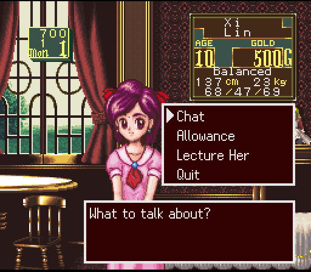
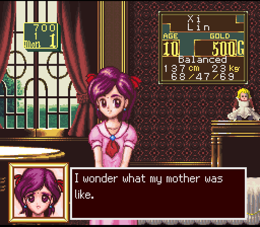
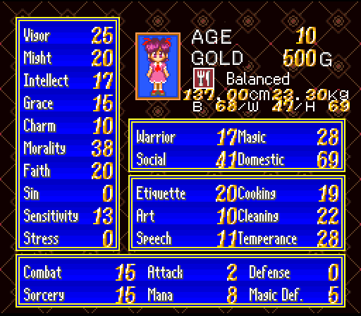
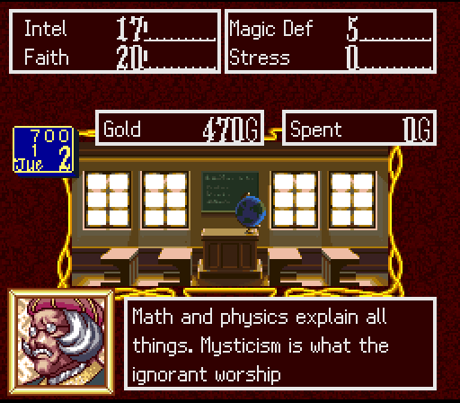
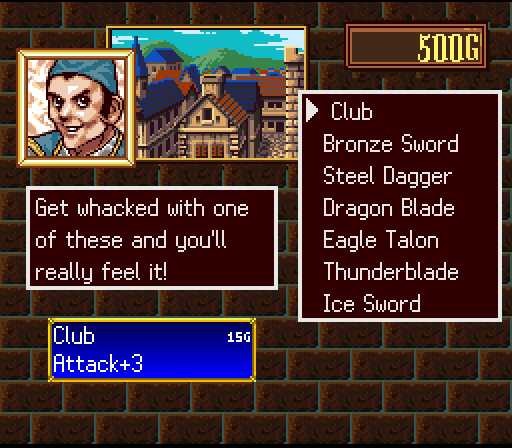
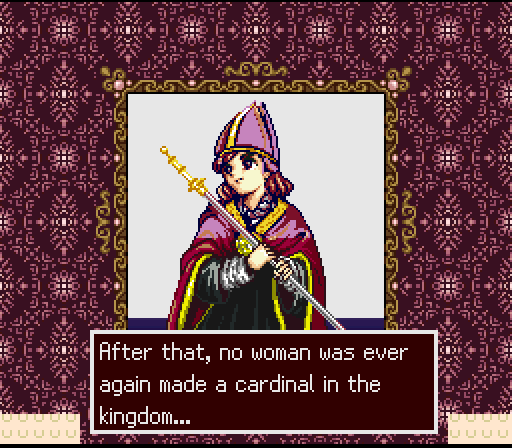

# Princess Maker: Legend of Another World, English Patch

An English translation patch for *Princess Maker: Legend of Another World*, the 1995 Super Famicom game, with
optional patches that fix bugs in the original game and rework its Quest mode.

Something of a slimmed-down take on *Princess Maker 2*, *Legend of Another World* has you raise Melody Blue, a girl
from the faery realm. Ten years ago you were the kingdom's greatest swordsman, fated to die in battle, until the Faery
King saved your life. Now a girl with no memory has been found at the edge of a forest, a white stag at her side, and
the stag turns out to be a faery who brings the Faery King's request: that you raise her as your own daughter. As the
old hero, you take in a foster daughter, with the stag as your butler, and for eight years, from age ten to eighteen,
you choose her lessons, jobs, quests and vacations. How you raise her decides which of dozens of endings she reaches.

This repository holds the patches and their source: the patch code, the English script, the English font and the
tools to build it. It does not contain the game.

**This is a work in progress.** The game is playable in English, but the script is still being polished, and some
screens still show Japanese text or layout glitches. Bug reports and awkward lines are welcome in the issues.

## Screenshots

| | |
| --- | --- |
|  |  |
|  |  |
|  |  |

### A few lines

> **Maya:** The most beautiful, kind and cleverest girl in the world, everyone's fave, the great sorceress Maaaya!

> **The science teacher:** Math and physics explain all things. Mysticism is what the ignorant worship.

> **Dizease, a demon:** These days even a demon's gotta be lovable!

> **The armorer:** Get whacked with one of these and you'll really feel it!

> **The butler:** Master, if you buy such junk and bankrupt the house, don't blame me!

> **Your daughter:** No way!! Father always told me demons are nothing but liars!

> **Your daughter:** Father, thank you for loving me and raising me all these years...

## How to play

Underneath the cute graphics this is a stat management game, and it punishes you for trying to do everything at once.
Working the farm and then studying etiquette doesn't add up to much for most endings. Pick a couple of stats that
complement each other and pour everything into them, while keeping the baseline ones in check.

**The loop.** Each month you schedule three parts: School, Work, Quest or Rest. Work earns the gold that pays for
school, school makes her better at her jobs, and better jobs earn more gold. Around that loop come random events with
their own pros and cons, visits to the castle, quests for more events and bounties, and plain fooling around to see
the endings. Nothing tells you outright what does what: when she starts acting up, open the status screens, note her
stats, and match her behaviour to them.

**Thresholds beat totals.** The endings and events mostly check whether a stat has reached a mark, such as 200 or
250, not how high it climbs past it. It's fine to push one area to the marks you want and then pivot to another,
say from the farm and combat school to etiquette or the hairdresser, going back and forth to keep the marks you
already reached.

**Watch these** (read from the game's code):

- **Stress against Vigor.** Once Stress is 90 or more above Vigor, she falls ill. The Illness gauge on her profile
  page tracks this.
- **Stress against Morality and Faith.** Stress far above the higher of the two pushes her towards delinquency, the
  Delinquency gauge on her profile page. At 60 or more above, there is a 1 in 20 chance each month that she runs away;
  at 100 above, she is arrested.
- **Sensitivity as her top stat.** If Sensitivity is the highest of her nine base stats (Vigor through Sensitivity),
  there is a 1 in 4 chance each month that she runs away. Keep something else above it.

**Want to know what decides each ending?** [ENDINGS.md](ENDINGS.md) lists every ending and the stats behind it,
read from the game's code. Be warned: knowing the endings spoils a lot of the magic of the series. Finding out what
she becomes without the rules is half the fun, so consider saving it for after your first playthrough.

**You will mess up**, and you'll learn from it. She might fall in with a bad crowd, get arrested, or run away from
home, and that's all part of the Princess Maker experience. Save often and try again.

## The patches

Apply **one** IPS patch from [`dist/`](dist/) to the unmodified Japanese ROM (don't stack them), with any IPS patcher
(Floating IPS, Lunar IPS, or an online patcher such as Rom Patcher JS):
*Princess Maker - Legend of Another World (Japan).sfc*, 2 MiB, no copier header,
md5 `135ad0c718e88aaa9de9ce848b47753a`.

| Patch | What you get |
| --- | --- |
| `princess-maker-en.ips` | The English translation. The game plays exactly as the original. |
| `princess-maker-en-bugfix.ips` | The translation plus fixes for bugs in the original game. |
| `princess-maker-en-questing.ips` | The translation, the bug fixes, and a reworked Quest. |

### Bug fixes (`-bugfix` and `-questing`)

- **The demon deal** (a quest cave): signing his contract outright no longer pays out a leftover sum of gold, and once
  she has signed, the demon never appears again (the original reset its flag every month). Signing for his 500 or
  1000 Gold still gives the gold and the contract, as in the original.
- **The jester**: after his farewell he is gone from the castle, instead of still being visitable there.
- **The Demon King's proposal**: in the hero ending where she slays the Demon King, he no longer turns up afterwards
  to ask for her hand.
- **The young dragon's proposal**: when the young dragon and his grandfather come to ask for her hand and you answer
  **Allow It**, he now comes back for her at the end, as he promises. In the original nothing ever recorded your answer,
  so his marriage ending could never happen. Answering **Refuse** works as before.

### Quest rework (`-questing` only)

- **Going home early** raises her Warrior or Magic Reputation by the days she was actually out, not every scheduled day (the
  original counted all 10 days for a quest abandoned on day 2). `-bugfix` keeps the original exploit for players who want it.
- **Peaceful people** (travelers, mages, soldiers) cost 30 Morality to defeat or to kill, the game's own
  penalty. Bandits, kidnappers and outlaws can still be fought freely.
- Asking a peaceful person for nothing never starts a fight.
- The approach menu lists Smile first, so the cursor starts on the friendly option.

## The translation

The script is localized rather than translated word for word: it aims to read the way a good English release of a
Super Nintendo game from the mid-90s would, with natural dialogue, each character's own voice, and short menu words,
while keeping the meaning, the jokes and the tone of the Japanese. The text is drawn in a new variable-width font, and
menus, status screens, the festival boards, the item cards and other text drawn as graphics are redrawn in English.

### AI disclosure

AI was used to make this translation. Local machine-translation models produced first drafts, and a human reviewed each
line in its context so it reads naturally and fits the game's text boxes, tone and characters. Claude (Anthropic) also
helped with the ROM hacking itself: tracing the game's code, writing the patch modules and fixing bugs in the original
game.

## Building

Python 3.10+ and Pillow. Put the Japanese ROM at `roms/base.sfc`, then:

    python3 -I tools/rom/build.py                       # dist/princess-maker-en.ips
    python3 -I tools/rom/build.py --variant bugfix      # dist/princess-maker-en-bugfix.ips
    python3 -I tools/rom/build.py --variant questing    # dist/princess-maker-en-questing.ips

| Path | What |
| --- | --- |
| `src/patches/` | The translation, one module per concern, applied in name order. |
| `src/gamefix/` | The optional bug fixes and quest rework. |
| `src/text/script-en.json` | The English script, keyed by each text run's address in the ROM. |
| `src/font/` | The English variable-width font and redrawn graphics. |
| `tools/` | Building, script dumping, disassembly and graphics tools (see [`tools/README.md`](tools/README.md)). |

The script file holds only English; layout decisions the build makes from the Japanese (line length, labels,
punctuation) are stored as a mask with every Japanese letter replaced by `x`.

## Credits

Thanks to the excellent [Bapsago](https://www.youtube.com/@bapsago) for documenting several of the original game's bugs
fixed here.

*Princess Maker: Legend of Another World* © 1995 Gainax, Takara. This is an unofficial fan translation, not affiliated
with or endorsed by the rights holders. Distribute the patches only, never the ROM.
